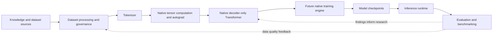

# XYNOOS Cyber-Model

> Native model engineering for systems research.

[](https://github.com/samuelindra123/xynoos-cyber-model/actions/workflows/ci.yml)
[](LICENSE)
[](docs/ROADMAP.md)

XYNOOS Cyber-Model is an independent, early-stage research project to develop a specialized language model and native machine-learning infrastructure, with a CPU-first and hardware-agnostic design. The numerical foundation uses safe Rust, with Python for independent validation. C remains a possible future implementation language.

The project is not a wrapper around commercial AI APIs. Its model architecture, tensor engine, autograd, tokenizer, and future training and inference runtimes are developed natively. Language-model weights will start from random initialization. No trained model, validated domain capability, benchmark result, or production runtime is claimed to exist today.

## Research objectives

The project will investigate how to build a technically useful and resource-conscious language model for systems engineering topics. Planned knowledge domains include:

- Cybersecurity, defensive security, digital forensics, and reverse engineering
- Linux kernel and userspace, operating systems, and system programming
- Computer networking, architecture, and memory management
- Low-level programming, embedded systems, and performance engineering
- Cryptography and technical troubleshooting

These are target research areas, not validated capabilities of a current model.

## Engineering philosophy

- CPU-first, hardware-agnostic computation with careful memory use
- Native, modular machine-learning infrastructure and independently trained weights
- Reproducible research and evidence-based optimization
- Numerical correctness, scientific evaluation, and transparent documentation
- Safe resource management and responsible cybersecurity research
- Use established open-source mathematical libraries when justified; build components from scratch when it provides a clear educational, research, performance, or architectural benefit

## System architecture and current model identity

The reference Transformer and tokenizer are implemented. A sustained language-model training engine and production inference runtime remain future work.



The current reference architecture uses tied embeddings, RoPE, causal multi-head attention, pre-RMSNorm, and SwiGLU. Checkpoint serialization, sustained training, production inference, quantization, and optional retrieval infrastructure remain future work.

## Development and compute strategy

Local work is limited to source and documentation changes, formatting, static checks, small numerical or tokenizer experiments, lightweight inference checks, and bounded smoke tests. Large training runs, large dataset downloads, prolonged CPU saturation, and unbounded allocations are not run automatically on developer machines.

GitHub Actions provides bounded repository and numerical checks. Future milestones may add manually triggered controlled experiments. Jobs should have timeouts, concurrency limits, deterministic seeds where appropriate, bounded inputs, and explicit artifact retention. Actions are not unlimited general-purpose compute: experiments must fit platform policies, resource limits, and available billing allowances. Work beyond those limits requires dedicated research compute or external cloud infrastructure; paid infrastructure requires explicit authorization.

## Current status

**Experimental architecture candidate awaiting language-model training.** XYNOOS Cyber 0.1 (`xynoos-cyber-0.1`) is a randomly initialized, native Rust decoder-only Transformer with 914,400 parameters, eight blocks, four attention heads, hidden dimension 96, feed-forward dimension 256, vocabulary size 292, and context capacity 128 tokens. TASK 005 accepted its CPU reference forward pass and a candidate-scoped backward pass for batch `B=1`, sequence length `T=32`; all 914,400 gradient values were finite in the audited candidate run. This does not establish training convergence, useful language-model intelligence, cybersecurity knowledge, text-generation quality, production throughput, or a production inference runtime. No model weights are published. [TASK 005 acceptance](docs/reports/TASK-005-D-FINAL-ACCEPTANCE-REPORT.md) · [Architecture](crates/xynoos-transformer/README.md) · [Versioning policy](docs/MODEL_VERSIONING.md)

## Roadmap

1. **TASK 001 — Repository and Research Foundation:** documentation, licensing, governance, lightweight CI, and development policies.
2. **TASK 002 — Numerical Computing Foundation:** architecture decisions, tensor representation, numerical correctness, ownership, and matrix operations.
3. **TASK 003 — Differentiation and Optimization:** gradients, backpropagation, losses, optimizers, and numerical gradient checks.
4. **TASK 004 — Tokenization and Dataset Infrastructure:** tokenizer research, provenance, processing, and streaming pipelines.
5. **TASK 005 — Native Reference Transformer:** accepted architecture specification and independently verified bounded forward/backward candidate execution.
6. **TASK 006 — Training Engine and First Experiment:** first evaluate data quality, tokenizer suitability, architecture constraints, and measured compute feasibility; then establish native optimizer, training, checkpoint, resume, and evaluation gates. No run or token budget is approved yet.
7. **TASK 007 — Inference Runtime:** model loading, generation, sampling, and lightweight local inference.
8. **TASK 008 — Domain Knowledge Infrastructure:** Linux, operating systems, cybersecurity, networking, low-level programming, and technical documentation.
9. **TASK 009 — Domain-Specific Training and Evaluation:** focused experiments, technical accuracy, reliability, and uncertainty handling.
10. **TASK 010 — Performance Engineering:** CPU optimization, memory efficiency, quantization, benchmarking, and reproducibility.

Future research may explore larger architectures, retrieval, improved technical reasoning, authorized training infrastructure, and model distribution. Numeric model versions follow the [versioning policy](docs/MODEL_VERSIONING.md); possible parameter targets are not commitments. No completion percentages, deadlines, or performance targets are asserted before baselines exist. See [the detailed roadmap](docs/ROADMAP.md).

## Repository structure

```text
.
├── .github/                 # CI and contribution templates
├── benchmarks/              # Benchmark policy and future results
├── crates/xynoos-autograd/   # Bounded reverse-mode AD and SGD
├── crates/xynoos-tensor/     # Dense CPU tensor reference library
├── datasets/                # Dataset governance; no corpus is included
├── docs/                    # Architecture, policies, and milestone reports
├── experiments/             # Controlled experiment guidance
├── models/                  # Model artifact guidance; no weights are included
├── research/                # Research notes guidance
└── tools/                   # Bounded oracle and repository checks
```

## Reproducibility

Future experiments should record source revisions, dataset versions and provenance, configuration, deterministic seeds when applicable, environment assumptions, resource bounds, and evaluation methods. Results must distinguish measured observations from hypotheses. Dataset and checkpoint artifacts should be versioned and stored through suitable artifact infrastructure rather than committed as large binaries.

## Responsible cybersecurity research

The intended use is legitimate education, defensive security, secure software engineering, authorized testing, system hardening, incident response, and responsible vulnerability disclosure. Research and evaluation should use controlled, isolated environments and authorized materials. No automated interaction with real third-party systems is part of this project initialization. Future evaluations should assess technical accuracy, reliability, uncertainty handling, and responsible behavior.

## Contributing

Contributions should be reproducible, scoped, technically supported, and consistent with the [contribution guide](CONTRIBUTING.md), [security policy](SECURITY.md), dataset policy, and code of conduct. Research proposals should state assumptions, methods, resource bounds, and evaluation criteria.

## License and intellectual property

Source code is licensed under [Apache License 2.0](LICENSE). Dataset licenses, third-party documentation licenses, future model-weight licensing, third-party dependency licenses, and generated research artifacts require separate review. Public accessibility alone does not grant redistribution or training rights. See [dataset policy](docs/DATASET_POLICY.md).
