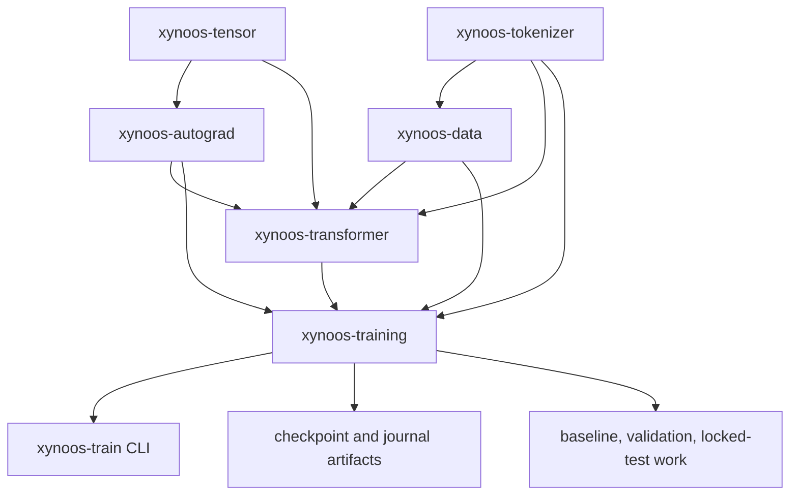

# TASK 006 Engineering Inventory

**Observed:** 2026-11-26, before TASK 006-R2 edits  
**Repository:** `samuelindra123/xynoos-cyber-model`  
**Default branch:** `main` at `32eca2b900c4f7a88294f7a24a5dfae0604ae798`  
**Active implementation branch:** `feat/task-006-r-runtime-remediation` at `999cfce89f62cfaf7a5fc5ab2da1d9c7c1c21afe`

## Repository and review state

| Item | Observed state |
|---|---|
| `main` | Local and remote refs matched `32eca2b900c4f7a88294f7a24a5dfae0604ae798`. |
| PR #21 | Open draft, `feat/task-006-r-runtime-remediation` → `audit/task-006-c-native-training-verification`; head `999cfce89f62cfaf7a5fc5ab2da1d9c7c1c21afe`. Foundation CI run `45754218041`, job `139688909833`, passed on that exact head. |
| PR #20 | Open draft, `audit/task-006-c-native-training-verification` → `feat/task-006-b-native-training-engine`; head `231d47d2d95f52770fa20f4da93a91be762178d0`. Foundation CI run `45731891128`, job `139615696369`, passed on that exact head. |
| C2 reports | Two pre-existing untracked audit reports were preserved byte-for-byte and committed separately as `8cb5257b0ff6911d4a3c3857a4faf47d4678f676` on `audit/task-006-c2-reverification`. |
| PR and main writes | No PR was merged, no workflow was dispatched, and `main` was not modified. |

The independent C2 report rejects TASK 006-R pending three findings: a reproduced stale-lock double-admission race (High), unverified CLI source cleanliness (Medium), and non-transactional initial sidecar publication (Low). The evidence and limits are preserved in [the C2 report](TASK-006-C2-INDEPENDENT-REVERIFICATION.md) and [its test evidence](TASK-006-C2-TEST-EVIDENCE.md).

## Runtime and research module map

| Area | Primary files | Role and dependencies |
|---|---|---|
| Tensor engine | `crates/xynoos-tensor/src/` | Bounded FP32 tensor values and native operations. |
| Autograd and optimizer | `crates/xynoos-autograd/src/` | Parameter ownership, tape/backward operations, AdamW and resource ledgers; builds on the tensor engine. |
| Tokenizer | `crates/xynoos-tokenizer/src/` | Native byte-BPE artifact parsing and tokenization. |
| Dataset | `crates/xynoos-data/src/` | Manifest validation, split isolation and bounded deterministic batch streaming. |
| Transformer | `crates/xynoos-transformer/src/` | Fixed native decoder model and initialization; uses tensor, autograd, tokenizer and data APIs. |
| Training engine | `crates/xynoos-training/src/{config,data,memory,schedule,trainer,checkpoint,journal,runtime}.rs` | Immutable identity, resource admission, training state machine, checkpoint codec, lineage journal, logs and stop handling. |
| Runtime CLI | `crates/xynoos-training/src/bin/xynoos-train.rs` | Configuration admission, artifact-root lifecycle, direct/detached launch, status, stop and checkpoint inspection. |
| Runtime process tests | `crates/xynoos-training/tests/cli_process.rs` | Detached process lifecycle, stop/resume, crash recovery and admission behavior. |
| Independent optimizer fixtures | `tools/adamw_reference.py`, `tools/fixtures/task006-adamw.tsv` | Standard-library numerical reference and frozen update records. |
| Objective A fixture | `tools/task006_objective_a.py`, `crates/xynoos-training/tests/fixtures/objective_a.json` | Deterministic project-authored learning-control data; not evidence of cybersecurity capability. |
| CI | `.github/workflows/ci.yml` | Bounded deterministic build, tests, numerical oracles, repository hygiene, Clippy, formatting and docs. |
| Manual training workflow | `.github/workflows/train-cpu.yml` | Bounded CPU dispatch proposal; absent from `main` at inventory time and never dispatched. |

## Phase dependencies

1. Close and independently re-verify R2 ownership, provenance and sidecar initialization before D1 work.
2. Add D1 baseline, multi-batch validation, locked-test isolation and leakage reporting on top of the corrected runtime identity.
3. Complete D2 private checkpoint persistence without putting model weights in Git or public releases.
4. Inspect D3 provider capabilities and measured workload feasibility without provisioning compute.
5. Assemble E only after the scientific evaluation, artifact recovery and resource gates are supported by evidence.

The accepted model configuration is fixed at 914,400 FP32 parameters, 74 tensors, vocabulary 292, context 128 and training windows `[1,32]`. The current Objective A fixture has only two train, two validation and two test rows. C2 reports that current validation evaluates one batch and no separately locked test path exists. The 24-update, 768-token, three-rate proposal is therefore not accepted as scientifically sufficient.

## Evidence boundaries at inventory time

- **Source present:** TASK 006-A architecture, TASK 006-B implementation, TASK 006-C audit, TASK 006-R runtime, numerical fixtures and a manual CPU workflow proposal.
- **Hosted CI observed:** the exact PR #20 and #21 heads listed above passed Foundation CI.
- **Independently reproduced in C2:** the stale-lock race and the bounded package regression summarized by the C2 reports.
- **Not established:** a run of `.github/workflows/train-cpu.yml`, any TASK 006-D training experiment, private checkpoint persistence, Colab/SSH disconnect survival, external artifact transfer or provider cleanup.
- **Authorization boundary:** implementation and bounded validation are authorized; no training dispatch, paid compute, external dataset acquisition, public weight upload or PR merge is authorized.
